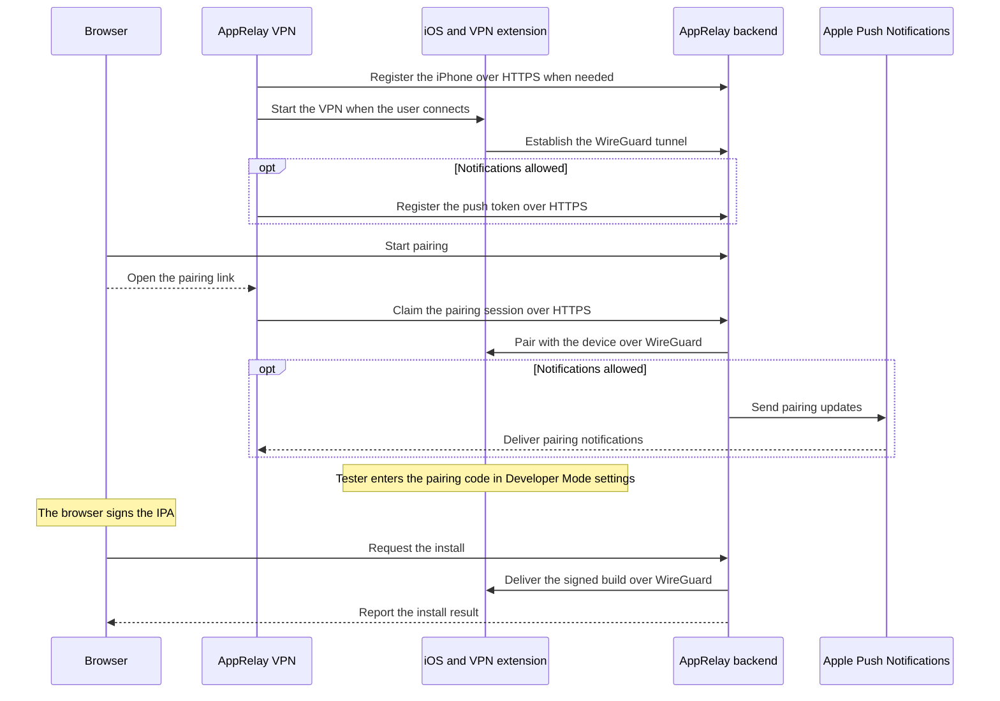

# AppRelay VPN for iPhone and iPad

AppRelay VPN connects an iPhone or iPad to [apprelay.app](https://apprelay.app) so the server can pair with the device and deliver development builds. The companion app does not sign or install IPAs itself: signing happens in the browser, and the server delivers the signed build to iOS over WireGuard.

[Get AppRelay VPN on TestFlight](https://testflight.apple.com/join/yW4QnZEg) · [Pair and install a build](../../README.md#sign-and-install-on-your-iphone)

VPN, pairing, and build delivery require a physical iPhone or iPad running **iOS/iPadOS 27 or later**. Simulator supports a UI-only preview. Expo Go, Android, and web are not supported.

## Configuration

For local builds, copy [`.env.local.example`](.env.local.example) to `.env.local`. For TestFlight, copy [`.env.testflight.example`](.env.testflight.example) to `.env.testflight`. Keep any existing files. The build commands load only the file for the selected environment, so fill in the required settings separately.

### App and server

| Variable                  | Default or requirement  | Purpose                                                                                                                                                                 |
| ------------------------- | ----------------------- | ----------------------------------------------------------------------------------------------------------------------------------------------------------------------- |
| `EXPO_PUBLIC_APP_SCHEME`  | Required                | Lowercase pairing link scheme without `://`. Match the web build's `VITE_APPRELAY_APP_SCHEME`. Examples: `apprelay-dev` for local builds and `apprelay` for TestFlight. |
| `EXPO_PUBLIC_VPN_API_URL` | Required                | HTTPS API base URL, e.g. `https://apprelay.app` for the hosted API. No credentials, query, or fragment.                                                                 |
| `EXPO_PUBLIC_VPN_HOST`    | Required                | WireGuard server hostname or IP, without a scheme or port. It must be reachable directly over UDP.                                                                      |
| `EXPO_PUBLIC_VPN_PORT`    | `51820`                 | WireGuard UDP port. Match the server's listen port.                                                                                                                     |
| `EXPO_PUBLIC_API_KEY`     | Required                | 64-character hex app key matching the server's `APPRELAY_API_KEY`.                                                                                                      |
| `APPLE_BUNDLE_IDENTIFIER` | Required                | Explicit bundle ID registered to your Apple Developer team. Use a separate ID if you want local and TestFlight builds installed side by side.                           |
| `APPLE_TEAM_ID`           | Required for TestFlight | Apple Developer Team ID for signing.                                                                                                                                    |
| `APPRELAY_GO_BINARY`      | `go1.19.13`             | Absolute path to the required Go executable if Xcode cannot find it.                                                                                                    |

### TestFlight and telemetry

| Variable                         | Default or requirement                | Purpose                                                                                                                                   |
| -------------------------------- | ------------------------------------- | ----------------------------------------------------------------------------------------------------------------------------------------- |
| `APPLE_BUILD_NUMBER`             | Required for TestFlight               | Last used integer build number; use `0` before the first upload. The publish command increments it.                                       |
| `APPLE_API_KEY_ID`               | Optional                              | App Store Connect API key ID. Set all three `APPLE_API_*` variables together to use API-key authentication instead of your Xcode account. |
| `APPLE_API_ISSUER_ID`            | Required with API key                 | App Store Connect key issuer ID.                                                                                                          |
| `APPLE_API_KEY_PATH`             | Required with API key                 | Absolute path to the App Store Connect `.p8` private key.                                                                                 |
| `EXPO_PUBLIC_SENTRY_DSN`         | Unset (disabled)                      | Public DSN for mobile error reporting.                                                                                                    |
| `EXPO_PUBLIC_SENTRY_ENVIRONMENT` | Unset                                 | Optional environment label for mobile error reports.                                                                                      |
| `SENTRY_ORG`                     | Required for TestFlight if DSN is set | Sentry organization slug.                                                                                                                 |
| `SENTRY_PROJECT`                 | Required for TestFlight if DSN is set | Sentry project slug.                                                                                                                      |
| `SENTRY_URL`                     | Required for TestFlight if DSN is set | HTTPS Sentry upload API base URL for your region.                                                                                         |
| `SENTRY_AUTH_TOKEN`              | Required for TestFlight if DSN is set | Build-only token for uploading source maps and debug symbols.                                                                             |

## How the app communicates



Keep the VPN connected and the iPhone on Wi-Fi during pairing and installation. See the [server diagram](../server/README.md#how-the-services-communicate) for the backend side of the workflow.

## Build and run

Use a Mac with Xcode and its command-line tools, CocoaPods, the [workspace Node.js and pnpm versions](../../README.md#local-development), and Go **1.19.13**. With Go already installed, install the required version:

```sh
go install golang.org/dl/go1.19.13@latest
"$HOME/go/bin/go1.19.13" download
```

Provision the app and its `<bundle identifier>.PacketTunnel` extension with your Apple Developer team and enable the Network Extension capability. Point your build at a reachable [AppRelay server](../server/README.md).

From the repository root:

```sh
pnpm install
pnpm ios
```

Select your connected iPhone and approve the device trust, signing, and VPN setup prompts as they appear. After changing native settings or dependencies, regenerate the iOS project with `pnpm --filter @apprelay/mobile prebuild:ios` and rebuild with `pnpm ios`. If the bundle ID changes, add `--clean` to prebuild to recreate the generated project.

### Preview in Simulator

With `.env.local` configured, run `pnpm ios:simulator` from the repository root and choose an iPhone Duo or iPad simulator. This regenerates the local `apps/mobile/ios` project without the WireGuard extension, so it doesn't need the pinned Go toolchain or device provisioning. Connect and pairing are disabled in the preview.

Switching back to a physical device requires regenerating the full project before building:

```sh
pnpm --filter @apprelay/mobile prebuild:ios --clean
pnpm ios
```

## Publish to TestFlight

Create an App Store Connect record for the distribution bundle ID and complete `.env.testflight`. Sign in to Xcode with an account that can sign and upload the app, or configure the App Store Connect API key above. From the repository root, run:

```sh
pnpm publish:ios:testflight
```

The command builds and uploads a signed archive from your Mac. If upload fails after archiving, the script prints the saved archive location so you can retry in Xcode Organizer. Do not edit `.env.testflight` or start another publish while a release is running.

After Apple processes the build, add it to a TestFlight group in App Store Connect. External testing may require beta review before you can share the public invite link.

## Security

- Treat `EXPO_PUBLIC_*` values as public: they are embedded in the app. The app key is extractable and does not replace device authentication.
- Keep App Store Connect private keys and Sentry upload tokens out of version control and out of `EXPO_PUBLIC_*` variables.
- Use a trusted HTTPS certificate on the API. For a local server, follow the [development certificate setup](../../infra/README.md#trust-the-development-https-certificate) rather than disabling TLS verification.
