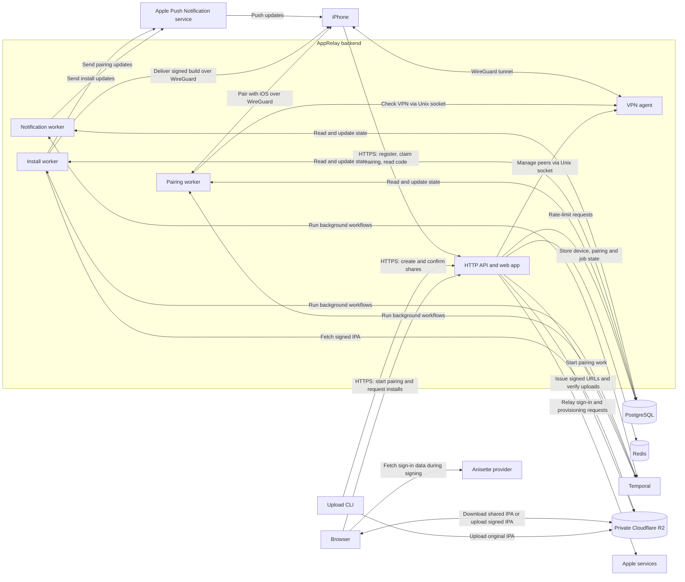

# AppRelay server

The backend for [apprelay.app](https://apprelay.app) serves the web app and API, coordinates iPhone pairing and installs, and issues upload and download URLs for shared builds. IPA signing happens in the browser, not on the server. For the user workflow, see the [AppRelay README](../../README.md).

## Configuration

Export runtime variables for each process or set them in the deployment environment. Native server processes do not load `.env` files. Defaults below are for native runs unless noted; see [`compose.coolify.yaml`](../../compose.coolify.yaml) for deployment overrides.

### API and workers

| Variable                           | Used by                          | Default                                    | Purpose                                                                                                                                 |
| ---------------------------------- | -------------------------------- | ------------------------------------------ | --------------------------------------------------------------------------------------------------------------------------------------- |
| `DATABASE_URL`                     | API, all workers                 | Required                                   | Private PostgreSQL connection URL.                                                                                                      |
| `REDIS_URL`                        | API                              | Required                                   | Private Redis URL for shared rate limits. Use `rediss://` for TLS.                                                                      |
| `PAIRING_ENCRYPTION_KEY`           | API, all workers                 | Required                                   | Persistent base64-encoded 32-byte key. Generate once with `openssl rand -base64 32` and share it across these processes.                |
| `APPRELAY_TEMPORAL_ADDRESS`        | API, all workers                 | `http://127.0.0.1:7233`                    | Temporal connection URL; required explicitly in Coolify.                                                                                |
| `APPRELAY_TEMPORAL_NAMESPACE`      | API, all workers                 | `default` (`apprelay` in Coolify)          | Existing Temporal namespace.                                                                                                            |
| `APPRELAY_HTTP_ADDRESS`            | API                              | `127.0.0.1:8080`                           | HTTP bind address behind the HTTPS proxy. Coolify binds to `0.0.0.0:8080` inside the container.                                         |
| `APPRELAY_WEB_DIR`                 | API                              | `web/dist` (`/opt/apprelay/web` in Docker) | Directory containing the built web app.                                                                                                 |
| `APPRELAY_ANISETTE_URL`            | API                              | Required                                   | Public HTTPS origin of an anisette v3 provider on port 443, reachable by the API and browser. No credentials, path, query, or fragment. |
| `APPRELAY_API_KEY`                 | API                              | Required                                   | 64-character hex app key for the `X-App-Key` header on device API requests. Must match the iOS build's `EXPO_PUBLIC_API_KEY`.           |
| `APPRELAY_TRUSTED_PROXY_CIDRS`     | API                              | Unset (trust none)                         | Comma-separated CIDRs of proxy peers allowed to supply `CF-Connecting-IP`. Required explicitly in Coolify.                              |
| `APPRELAY_DEVICE_LIFETIME_SECONDS` | API                              | `604800` (7 days)                          | Lifetime for new or renewed expired registrations. Existing active registrations keep their expiry.                                     |
| `APPRELAY_APNS_ENVIRONMENT`        | API                              | Required                                   | `sandbox` for development builds or `production` for TestFlight and App Store builds.                                                   |
| `APPRELAY_APNS_SIGNING_KEY_FILE`   | Notification and install workers | Required for notifications                 | Path to the APNs `.p8` signing key. The install worker can run without push notifications by leaving this unset.                        |
| `APPRELAY_APNS_KEY_ID`             | Notification and install workers | Required with signing key                  | Apple APNs key ID.                                                                                                                      |
| `APPRELAY_APNS_TEAM_ID`            | Notification and install workers | Required with signing key                  | Apple Developer team ID.                                                                                                                |
| `APPRELAY_APNS_TOPIC`              | Notification and install workers | Required with signing key                  | App bundle ID authorized by the signing key.                                                                                            |

### WireGuard

| Variable                        | Used by                        | Default                                                                                 | Purpose                                                                                   |
| ------------------------------- | ------------------------------ | --------------------------------------------------------------------------------------- | ----------------------------------------------------------------------------------------- |
| `APPRELAY_VPN_PRIVATE_KEY_FILE` | VPN agent                      | Required                                                                                | Path to a persistent WireGuard private key generated with `wg genkey`.                    |
| `APPRELAY_VPN_ADDRESS`          | VPN agent                      | `10.77.0.1/24`                                                                          | Server's WireGuard IPv4 address and subnet.                                               |
| `APPRELAY_VPN_PORT`             | VPN agent                      | `51820`                                                                                 | WireGuard UDP listen port.                                                                |
| `APPRELAY_VPN_AGENT_UID`        | VPN agent                      | `SUDO_UID`                                                                              | Non-root UID allowed to use the agent socket. The API and pairing worker run as this UID. |
| `APPRELAY_VPN_AGENT_SOCKET`     | VPN agent, API, pairing worker | `/var/db/apprelay/vpn-agent.sock` on macOS; `/var/run/apprelay/vpn-agent.sock` on Linux | Shared Unix socket path. Set the same path on all three if overriding.                    |

### R2 upload configuration

Set the five required variables on both the API and install worker to enable sharing and installs. Leave all R2 variables unset on the API to disable uploads, and do not run the install worker without R2. To set a finite lifetime in Coolify, pass `APPRELAY_IPA_LIFETIME_DAYS` to the API container. See the [R2 bucket setup](R2.md) for CORS and retention rules.

| Variable                        | Default            | Purpose                                                                                                         |
| ------------------------------- | ------------------ | --------------------------------------------------------------------------------------------------------------- |
| `APPRELAY_R2_ACCOUNT_ID`        | Required           | Cloudflare account ID.                                                                                          |
| `APPRELAY_R2_BUCKET`            | Required           | Dedicated private R2 bucket.                                                                                    |
| `APPRELAY_R2_ACCESS_KEY_ID`     | Required           | R2 S3 API access key with Object Read & Write access to that bucket only.                                       |
| `APPRELAY_R2_SECRET_ACCESS_KEY` | Required           | Corresponding R2 secret key.                                                                                    |
| `APPRELAY_PUBLIC_ORIGIN`        | Required           | Public HTTPS origin for share links, such as `https://apprelay.app`, without a path.                            |
| `APPRELAY_IPA_LIFETIME_DAYS`    | Unset (indefinite) | Retention for new shared IPAs and share links, in whole days (`1`–`65535`). Existing uploads keep their expiry. |

### Web build and telemetry

`VITE_*` values are public and embedded at build time. See [`web/.env.example`](web/.env.example) for local Vite configuration.

| Variable                   | Used by                     | Default                  | Purpose                                                                                                                                            |
| -------------------------- | --------------------------- | ------------------------ | -------------------------------------------------------------------------------------------------------------------------------------------------- |
| `VITE_APPRELAY_APP_SCHEME` | Web build                   | Unset (pairing disabled) | Pairing link scheme. Must match the iOS build's `EXPO_PUBLIC_APP_SCHEME`.                                                                          |
| `VITE_UMAMI_SCRIPT_URL`    | Web build                   | Unset                    | Public HTTPS Umami tracker URL. Set both Umami variables to enable production analytics.                                                           |
| `VITE_UMAMI_WEBSITE_ID`    | Web build                   | Unset                    | Public Umami website ID.                                                                                                                           |
| `APPRELAY_LOG_LEVEL`       | API, VPN agent, all workers | `info`                   | Minimum log level: `error`, `warn`, `info`, `debug`, `trace`, or `off`.                                                                            |
| `SENTRY_DSN`               | API, VPN agent, all workers | Unset (disabled)         | Runtime Sentry DSN.                                                                                                                                |
| `SENTRY_ENVIRONMENT`       | API, VPN agent, all workers | SDK default              | Runtime Sentry environment.                                                                                                                        |
| `SENTRY_RELEASE`           | Runtime and builds          | Unset                    | Release identifier, such as a commit SHA. Docker carries its build value into runtime unless overridden.                                           |
| `VITE_SENTRY_DSN`          | Web build                   | Unset (disabled)         | Public Sentry DSN for production web builds.                                                                                                       |
| `VITE_SENTRY_ENVIRONMENT`  | Web build                   | `production`             | Sentry environment for the web app.                                                                                                                |
| `SENTRY_AUTH_TOKEN`        | Build only                  | Unset                    | Required for Sentry uploads when `VITE_SENTRY_DSN` or `SENTRY_BACKEND_PROJECT` is set. In Docker, pass as a BuildKit secret, not a build argument. |
| `SENTRY_ORG`               | Build only                  | Unset                    | Sentry organization slug, required for either upload.                                                                                              |
| `SENTRY_PROJECT`           | Web build                   | Unset                    | Sentry project slug, required when `VITE_SENTRY_DSN` is set.                                                                                       |
| `SENTRY_BACKEND_PROJECT`   | Docker build                | Unset                    | Sentry project slug; setting it enables backend debug-symbol and source uploads.                                                                   |

### Coolify deployment

| Coolify setting                       | Default                 | Purpose                                                                               |
| ------------------------------------- | ----------------------- | ------------------------------------------------------------------------------------- |
| `APPRELAY_DOCKER_NETWORK`             | `coolify`               | Existing private Docker network that can reach PostgreSQL and Temporal.               |
| `APPRELAY_IMAGE`                      | `apprelay-server:local` | Shared image tag for the API, agent, and workers.                                     |
| `APPRELAY_VPN_PRIVATE_KEY_HOST_FILE`  | Required                | Absolute host path to the WireGuard key mounted into the agent.                       |
| `APPRELAY_APNS_SIGNING_KEY_HOST_FILE` | Required                | Absolute host path to the APNs key mounted into the notification and install workers. |

## How the services communicate



1. **Share:** The CLI asks the API for an upload URL, sends the IPA directly to R2, then confirms the upload. Testers open the resulting share link in the browser.
2. **Pair:** The browser opens a pairing session. Once the iPhone claims it, Temporal coordinates the work and the pairing worker talks to iOS over WireGuard. The notification worker sends pairing updates through APNs.
3. **Install:** The browser signs the shared or local IPA, uploads the signed build to R2, and confirms the install request. The install worker picks up the confirmed job, fetches the build from R2, and installs it over WireGuard. The browser reads the result from the API.

## Run locally

Start PostgreSQL, Redis, Temporal, and Caddy using the [local infrastructure guide](../../infra/README.md). Run the backend processes natively on macOS or Linux. On macOS, install `wireguard-go` and `wg`; on Linux, enable kernel WireGuard and install `ip` and `wg`. Linux pairing also requires `CAP_NET_RAW` for the pairing worker.

After exporting the settings above, run these commands from the repository root in separate terminals:

```sh
pnpm --filter @apprelay/server vpn:agent             # Starts the agent with sudo
pnpm server                                         # API and built web app
pnpm --filter @apprelay/server pairing:worker        # iPhone pairing
pnpm --filter @apprelay/server notifications:worker  # Pairing pushes (requires APNs)
pnpm --filter @apprelay/server install:worker        # Installs (requires R2)
```

Only the VPN agent runs as root. The API and pairing worker need access to its Unix socket, and the pairing and install workers need access to its WireGuard interface. Run `pnpm web:dev` for the web dev server, or `pnpm web:build` to serve a production web build from the API.

## API and diagnostics

- [`/health`](https://apprelay.app/health) checks API liveness, not database, workflow, or VPN readiness.
- [`/openapi.json`](https://apprelay.app/openapi.json) serves the API contract.
- Backend services emit structured logs to stdout. Sentry reports errors separately when configured.

## Security

- Serve public API traffic over HTTPS and expose the configured WireGuard UDP port. Keep the backend HTTP listener, PostgreSQL, Redis, Temporal, and pairing listeners off the public network.
- Keep VPN forwarding disabled. Limit VPN ingress to pairing discovery (UDP `5354`) and pairing listeners (TCP `20000`–`20049`) at the server's VPN address. Clients must not be able to route to one another, private networks, or the internet through the server.
- Trust only the immediate proxy peers you control in `APPRELAY_TRUSTED_PROXY_CIDRS`, and ensure they overwrite `CF-Connecting-IP`. Never trust client or VPN subnets. The shipped app key can be extracted and is not a substitute for device authentication.
- Keep keys outside version control. Use mode `0600` on key files, with the WireGuard key readable by the agent and the APNs key readable by the workers. Keep the R2 bucket private and scope credentials to that bucket.
- Redact share and session tokens from proxy logs (including `/s/*` and `/v1/artifacts/*`), and do not log request or response bodies.
